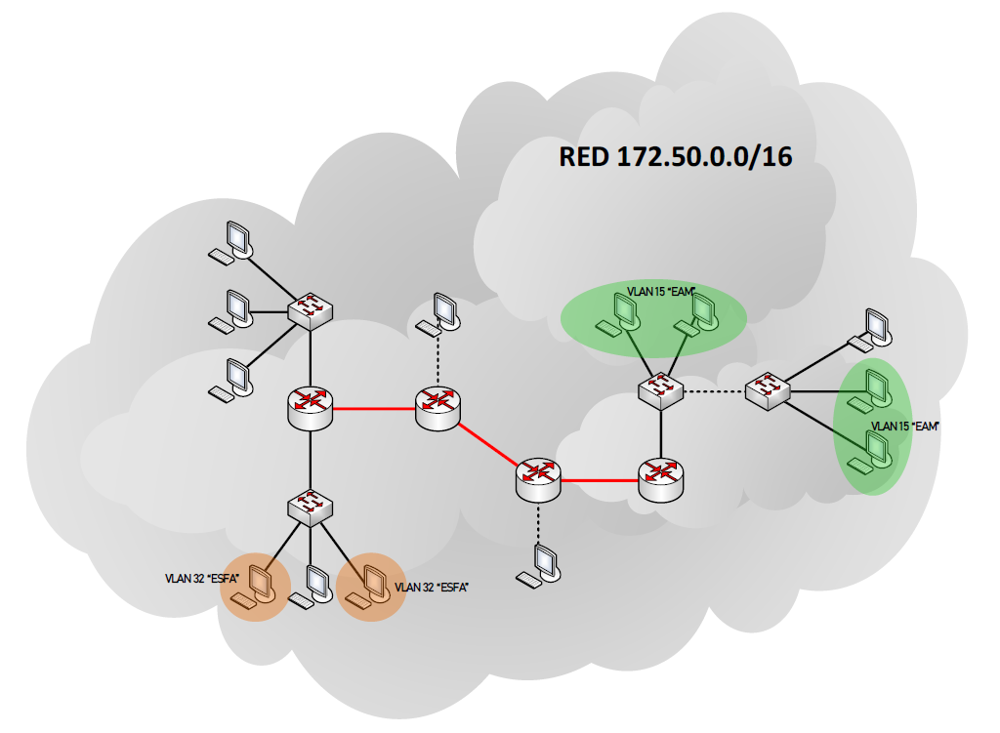

# Trabajo Práctico Integrador — Redes I

Diseño e implementación de una red segmentada con VLANs, trunking y encaminamiento estático en Cisco Packet Tracer.

## Datos académicos

| Campo | Detalle |
|---|---|
| Institución | Instituto Universitario Aeronáutico (IUA) |
| Facultad | Facultad de Ingeniería |
| Carrera | Ingeniería Informática |
| Materia | Redes I |
| Modalidad | Grupal |
| Fecha | 19/11/2026 |

## Autores

| Apellido y nombre |
|---|
| Sánchez, Santiago Javier |
| Ferreyra, Eduardo |
| Loza, Tomás |

## Descripción

El trabajo práctico integrador desarrolla el diseño y la configuración de una red de datos sobre la red base **172.50.0.0/16**. La solución contempla el direccionamiento IP, la segmentación mediante VLANs, los enlaces troncales entre switches, la configuración de dispositivos de capa 2 y 3, el acceso remoto mediante Telnet y SSH, y el encaminamiento estático entre las distintas redes.

El repositorio reúne el enunciado del trabajo, el diagrama de red y la simulación realizada en Cisco Packet Tracer.

## Objetivos

- Aplicar subnetting para organizar la red **172.50.0.0/16** en subredes funcionales.
- Configurar dispositivos de capa 2 y 3 con hostname, banner, fecha y hora, y contraseñas de acceso.
- Segmentar la red mediante las VLAN **15 (EAM)** y **32 (ESFA)**.
- Configurar enlaces troncales para transportar las VLANs entre switches.
- Habilitar el acceso remoto por Telnet y SSH con cuatro sesiones simultáneas.
- Implementar encaminamiento estático entre las redes de la topología.
- Verificar la conectividad y documentar el funcionamiento de la solución.

## Topología

El diagrama define la red base **172.50.0.0/16** y dos VLANs:

- **VLAN 15 — EAM**
- **VLAN 32 — ESFA**

La topología integra routers, switches y equipos finales. Los switches se conectan mediante enlaces troncales para transportar ambas VLANs y los routers utilizan encaminamiento estático para comunicar las distintas subredes.



> El diagrama y las consignas originales se encuentran en el documento [TRABAJO PRÁCTICO INTEGRADOR_B.docx](<TRABAJO PRÁCTICO INTEGRADOR_B.docx>).

## Consignas y su implementación

| Consigna | Implementación |
|---|---|
| Direccionamiento IP | Plan de subredes dentro de `172.50.0.0/16`, con máscaras `/24` para las LAN y `/30` para los enlaces entre routers. |
| Nombre/Hostname | Asignación de un nombre identificatorio a cada router y switch. |
| Mensaje de bienvenida | Banner `ACCESO SOLO USUARIOS AUTORIZADOS` en los dispositivos. |
| Fecha y hora | Configuración mediante el comando `clock set`. |
| Password de acceso | Contraseña para la línea de consola y contraseña de modo privilegiado. |
| Acceso remoto | Telnet y SSH habilitados con cuatro sesiones simultáneas (`line vty 0 3`). |
| VLANs | VLAN 15 para EAM y VLAN 32 para ESFA. |
| Trunking | Enlaces troncales 802.1Q entre switches. |
| Encaminamiento | Rutas estáticas para el intercambio de tráfico entre subredes. |
| Conclusiones | Análisis final del desarrollo, los temas estudiados y las recomendaciones. |

## Plan de direccionamiento IP propuesto

La red base es **172.50.0.0/16**. Se propone utilizar un bloque `/24` por cada dominio VLAN y un bloque `/30` por cada enlace punto a punto entre routers.

| Uso | VLAN | Subred | Máscara | Gateway | Rango usable | Broadcast |
|---|---:|---|---|---|---|---|
| EAM — sede 1 | 15 | `172.50.15.0` | `255.255.255.0` (`/24`) | `172.50.15.1` | `.2 – .254` | `172.50.15.255` |
| EAM — sede 2 | 15 | `172.50.16.0` | `255.255.255.0` (`/24`) | `172.50.16.1` | `.2 – .254` | `172.50.16.255` |
| ESFA — sede 1 | 32 | `172.50.32.0` | `255.255.255.0` (`/24`) | `172.50.32.1` | `.2 – .254` | `172.50.32.255` |
| ESFA — sede 2 | 32 | `172.50.33.0` | `255.255.255.0` (`/24`) | `172.50.33.1` | `.2 – .254` | `172.50.33.255` |
| Enlace R1–R2 | — | `172.50.100.0` | `255.255.255.252` (`/30`) | — | `.1 – .2` | `172.50.100.3` |
| Enlace R2–R3 | — | `172.50.100.4` | `255.255.255.252` (`/30`) | — | `.5 – .6` | `172.50.100.7` |

Si la topología final utiliza una sola sede por VLAN, alcanza con los bloques `172.50.15.0/24` y `172.50.32.0/24`; los bloques `172.50.16.0/24` y `172.50.33.0/24` quedan reservados para crecimiento o para una segunda sede.

> Esta tabla es una propuesta de diseño coherente con la red base del diagrama. Debe contrastarse con las direcciones efectivamente configuradas en la simulación `.pkt`.

### Asignación sugerida de hosts

| Rol | Dirección sugerida |
|---|---|
| Gateway de la VLAN | `.1` |
| PCs y dispositivos finales | `.10 – .49` |
| Servidores o equipos críticos | `.50 – .99` |
| Reserva para crecimiento o DHCP | `.100 – .200` |

## Configuraciones de referencia

> Los nombres de las interfaces pueden variar según el modelo de router o switch utilizado en Packet Tracer. Ajustar `GigabitEthernet`, `FastEthernet` y los números de puerto según la topología.

### Configuración básica de un router

```cisco
enable
configure terminal
hostname R1
banner motd #ACCESO SOLO USUARIOS AUTORIZADOS#
clock set 12:00:00 19 Nov 2026
enable secret <password-privilegiado>

line console 0
 password <password-consola>
 login
 exit

line vty 0 3
 password <password-remoto>
 login
 transport input telnet ssh
 exit
```

### Acceso remoto con SSH

```cisco
ip domain-name iua.edu.ar
crypto key generate rsa modulus 1024
username admin privilege 15 secret <password-admin>

line vty 0 3
 login local
 transport input ssh telnet
 exit
```

> Si se configura `login local` para SSH, la contraseña de línea VTY deja de utilizarse. Usar `login local` con usuarios locales o `password` con `login`, según el método de autenticación elegido.

### Creación de VLANs y configuración de acceso

```cisco
vlan 15
 name EAM
vlan 32
 name ESFA
exit

interface range FastEthernet0/1-10
 switchport mode access
 switchport access vlan 15
 exit
```

### Enlace troncal entre switches

```cisco
interface GigabitEthernet0/1
 switchport mode trunk
 switchport trunk allowed vlan 15,32
 exit
```

### Router-on-a-stick

```cisco
interface GigabitEthernet0/0
 no shutdown

interface GigabitEthernet0/0.15
 encapsulation dot1Q 15
 ip address 172.50.15.1 255.255.255.0

interface GigabitEthernet0/0.32
 encapsulation dot1Q 32
 ip address 172.50.32.1 255.255.255.0
```

### Encaminamiento estático

```cisco
ip route <red-destino> <máscara-destino> <ip-siguiente-salto>
```

Ejemplo de rutas en R1 hacia las redes remotas:

```cisco
ip route 172.50.16.0 255.255.255.0 172.50.100.2
ip route 172.50.32.0 255.255.255.0 172.50.100.2
ip route 172.50.33.0 255.255.255.0 172.50.100.2
```

## Verificación

Comandos útiles para comprobar la configuración en los dispositivos:

```cisco
show running-config
show vlan brief
show interfaces trunk
show ip interface brief
show ip route
show users
show ssh
```

Pruebas de conectividad:

```cisco
ping 172.50.32.10
traceroute 172.50.32.10
```

Resultados esperados:

- Las VLANs 15 y 32 aparecen activas en los switches.
- Los enlaces troncales transportan ambas VLANs.
- Cada PC obtiene conectividad con su gateway.
- Las rutas estáticas permiten alcanzar las redes remotas.
- El acceso por Telnet y SSH funciona con las credenciales configuradas.

## Estructura del repositorio

```text
Redes-I-TP/
├── README.md
├── docs/
│   └── diagrama-red.png
├── Trabajo practico integrador B.pkt
└── TRABAJO PRÁCTICO INTEGRADOR_B.docx
```

| Archivo | Descripción |
|---|---|
| `README.md` | Documentación general del trabajo. |
| `docs/diagrama-red.png` | Diagrama de red extraído del enunciado. |
| [Trabajo practico integrador B.pkt](<Trabajo practico integrador B.pkt>) | Simulación de la red en Cisco Packet Tracer. |
| [TRABAJO PRÁCTICO INTEGRADOR_B.docx](<TRABAJO PRÁCTICO INTEGRADOR_B.docx>) | Enunciado, consignas y diagrama original. |

## Cómo abrir el proyecto

1. Descargar o clonar el repositorio.
2. Instalar Cisco Packet Tracer (versión compatible con el archivo, preferentemente 8.x o superior).
3. Abrir `Trabajo practico integrador B.pkt`.
4. Revisar la topología y las configuraciones de cada dispositivo.
5. Ejecutar las pruebas de conectividad y comparar con el plan de direccionamiento.

## Conclusiones

- El direccionamiento jerárquico a partir de `172.50.0.0/16` permite organizar la red en subredes claras y escalables, separando las LAN de los enlaces punto a punto.
- La segmentación con VLANs reduce los dominios de broadcast, mejora el rendimiento y facilita la aplicación de políticas de seguridad por área.
- El trunking 802.1Q es fundamental para transportar varias VLANs por un mismo enlace y concentrar el direccionamiento en el router mediante router-on-a-stick.
- El encaminamiento estático es una solución simple y predecible para esta topología, aunque requiere mantener y actualizar manualmente las rutas ante cambios.
- El acceso remoto con SSH ofrece mayor seguridad que Telnet; por eso se recomienda usar SSH en entornos reales y reservar Telnet para prácticas de laboratorio.
- La verificación con comandos `show`, `ping` y `traceroute` permite validar cada etapa de la configuración y detectar errores de VLAN, trunking o rutas.

### Recomendaciones

- Documentar el direccionamiento y las interfaces utilizadas antes de configurar los dispositivos.
- Utilizar contraseñas robustas y diferentes para consola, modo privilegiado y acceso remoto.
- Deshabilitar los puertos y servicios que no se utilicen.
- Guardar una copia de la configuración de cada dispositivo (`copy running-config startup-config`).
- Probar la red ante fallas simuladas para comprobar la eficacia del encaminamiento y la segmentación.

---

Trabajo Práctico Integrador — Redes I · Instituto Universitario Aeronáutico (IUA) · Ingeniería Informática · 2026
